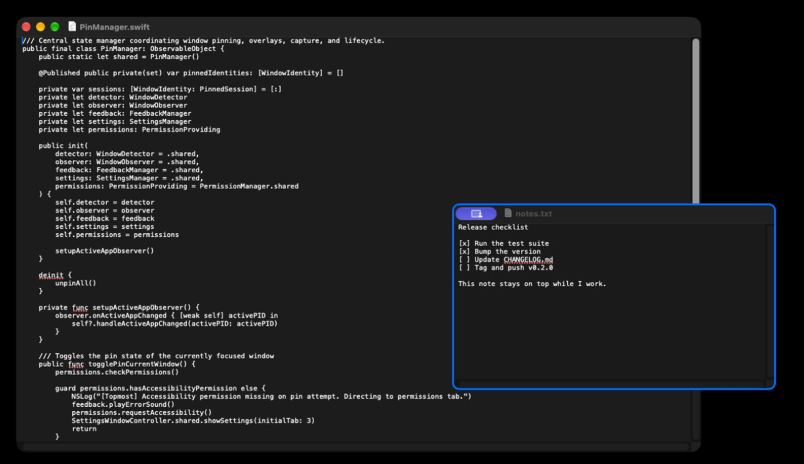
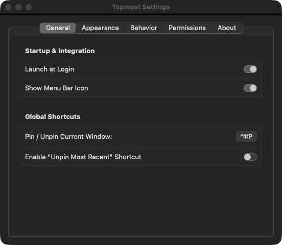
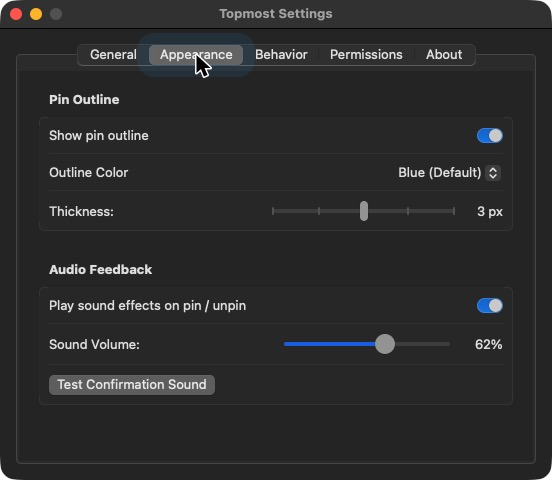
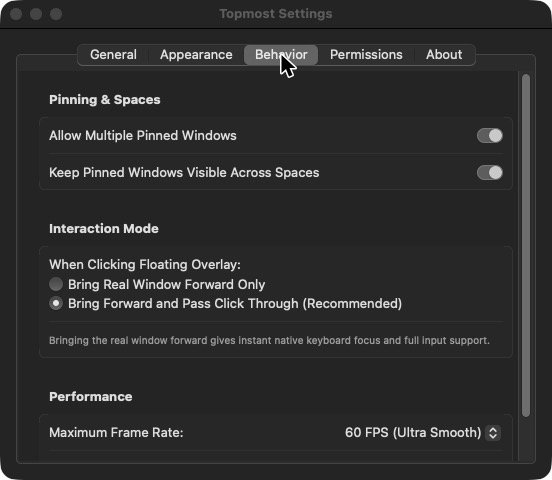
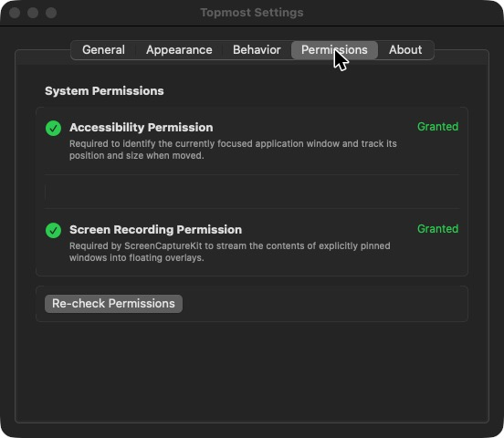
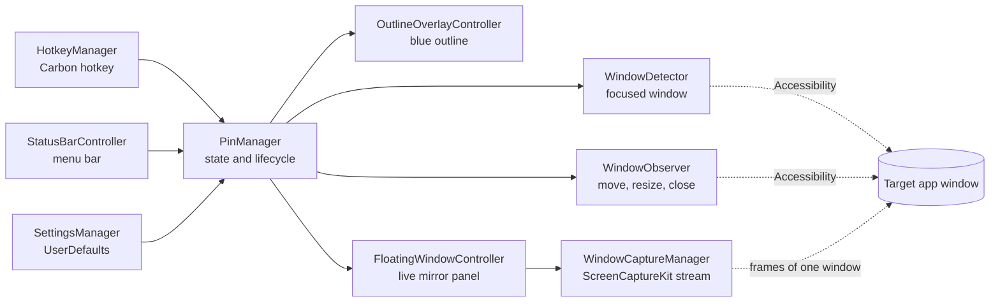
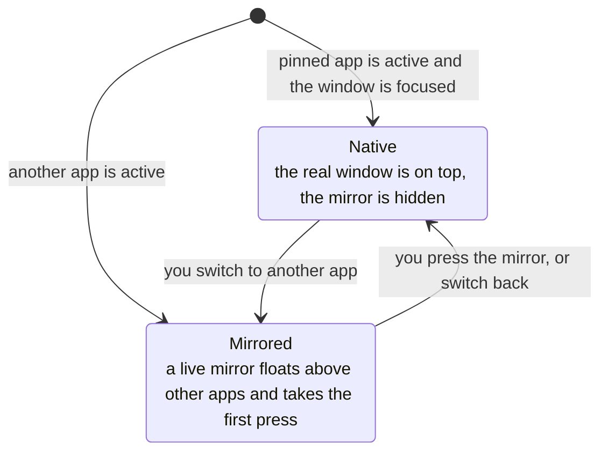
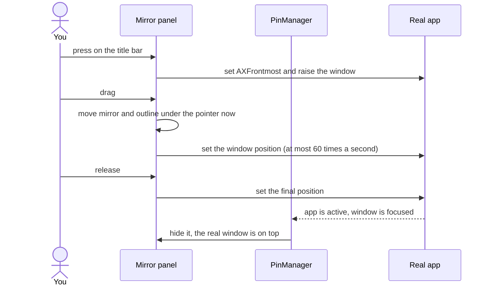

# Topmost

**Always on Top for macOS.** Pin any window above your other apps with one shortcut, and it stays there while you work. Built with Swift, AppKit, SwiftUI and ScreenCaptureKit.

[](https://github.com/jadhavgaurav/topmost/actions/workflows/ci.yml)
[](https://github.com/jadhavgaurav/topmost/releases/latest)
[](LICENSE)


Topmost is the macOS answer to the Always on Top feature in Windows PowerToys. Focus a window, press `Control + Command + P`, and that one window floats above everything else, with a blue outline so you can see which one it is. Press the shortcut again to let it go.



---

## Contents

- [Why Topmost](#why-topmost)
- [How to use it](#how-to-use-it)
- [Screenshots](#screenshots)
- [Features](#features)
- [Install](#install)
- [Permissions](#permissions)
- [How it works](#how-it-works)
- [Known limitations](#known-limitations)
- [Build from source](#build-from-source)
- [Test and release](#test-and-release)
- [Project layout](#project-layout)
- [Documentation](#documentation)
- [Contributing](#contributing)
- [Security](#security)
- [License](#license)

## Why Topmost

- **One shortcut, no setup screen.** Focus a window and press `Control + Command + P`. That is the whole workflow.
- **It pins one window, not an app.** Two TextEdit documents are two windows. Pin one and the other stays normal.
- **Native feel.** When the pinned window is the one you are using, you are working in the real window, with real dragging and no copy on top of it.
- **Private.** No network calls, no analytics, no files written. Nothing leaves your Mac.
- **Light.** Idle, Topmost uses about 1% of one CPU core. Dragging a pinned window takes a few percent.

## How to use it

1. Open any normal window: Notes, TextEdit, Terminal, Safari, Chrome, VS Code, Finder.
2. Focus it and press `Control + Command + P`. A blue outline and a short chime confirm the pin.
3. Switch to another app. The pinned window stays visible on top.
4. Click the pinned window, or drag it by its title bar, to bring its app forward and work in it. The first press does both, so you do not need to click twice.
5. Press `Control + Command + P` again, or choose **Unpin All Windows** from the menu bar icon, to release it.

The menu bar icon (a pin) lists every pinned window and gives quick access to Settings.

## Screenshots

| General | Appearance |
| --- | --- |
|  |  |
| **Behavior** | **Permissions** |
|  |  |

## Features

### Pinning

- Global shortcut `Control + Command + P` to pin or unpin the focused window.
- Optional shortcut `Control + Command + U` to unpin the most recently pinned window. Turn it on in Settings, General.
- The shortcut keys cannot be changed from Settings yet. Settings shows them, and a rebinding control is not built.
- Pin several windows at once, across displays and Spaces, or restrict Topmost to one pinned window.
- A pin is removed automatically when its window closes or its app quits.
- Menu bar item with the list of pinned windows, a one-click unpin for each, and **Unpin All Windows**.

### Interaction

- Press a pinned window while another app is active and Topmost brings that app forward and passes your press through, so a title bar drag or a button press works in one motion.
- Drag a pinned window by its title bar from anywhere. The outline follows the pointer without lag.
- Choose **Bring Real Window Forward Only** in Settings if you would rather the first click only switch apps.
- When the pinned window is the focused window of the active app, you are using the real window directly.

### Appearance and feedback

- A blue outline (`#007AFF`) that follows the window, with a color choice of blue, green, orange, purple, yellow or red, and a thickness from 1 to 5 px.
- Confirmation sounds for pin (`Tink`) and unpin (`Pop`), with a volume control and an off switch.

### Performance

- Capture frame rate of 15, 30 or 60 FPS, and a Low Resource Mode that caps capture at 15 FPS.
- Capture streams only the pinned window, never your display, and stops the moment you unpin.

### Settings

Open Settings from the menu bar icon. It has five tabs: General (launch at login, menu bar icon, the optional unpin shortcut), Appearance, Behavior (multiple pins, Spaces, click mode, frame rate), Permissions and About.

## Install

### One line

```bash
curl -fsSL https://raw.githubusercontent.com/jadhavgaurav/topmost/main/install.sh | bash
```

That downloads the latest release, checks it against the published SHA-256 checksum, installs Topmost to `/Applications`, and opens it. [Read the script first](install.sh) if you would rather see what it does.

### From the release page

1. Go to the [Releases page](https://github.com/jadhavgaurav/topmost/releases/latest) and download `Topmost-<version>-macos-universal.dmg`.
2. Open the DMG and drag **Topmost** onto the **Applications** shortcut.
3. Open Topmost from Applications. macOS says it could not verify Topmost, so click **Done** (not Move to Trash).
4. Allow it once:
   - Open **System Settings > Privacy & Security**, scroll to the message about Topmost, click **Open Anyway**, then enter your password.
   - Or run this in Terminal, then open Topmost again:

     ```bash
     xattr -dr com.apple.quarantine /Applications/Topmost.app
     ```

Topmost is not yet signed with an Apple Developer ID or notarized by Apple, which is why macOS shows this warning. Each release lists SHA-256 checksums. To check a download:

```bash
shasum -a 256 -c SHA256SUMS --ignore-missing
```

**Requirements:** macOS 14 (Sonoma) or later, on Apple Silicon or Intel.

## Permissions

Topmost asks for two permissions, and only uses them after you pin a window.

| Permission | Why |
| --- | --- |
| **Accessibility** | To find the focused window, follow it when it moves or resizes, and bring its app forward when you click it. |
| **Screen Recording** | To show a live picture of the pinned window. Capture is limited to that one window. |

Grant both under **System Settings > Privacy & Security**, then relaunch Topmost if macOS asks. The Permissions tab in Settings shows the current status. Details are in [docs/PERMISSIONS.md](docs/PERMISSIONS.md).

## How it works

macOS does not let one app change another app's window level, and the private APIs that do are blocked unless System Integrity Protection is off. Topmost does not use them. Instead it streams the pinned window with ScreenCaptureKit into a floating panel that sits above other apps, and hands control back to the real window the moment you use it.



### Two states, one rule

Each pinned window is always in one of two states, and the rule is that you never fight a copy of the window you are using.



- **Native.** The pinned window is the focused window of the active app. The mirror is hidden, so you drag, type and click in the real window with no lag.
- **Mirrored.** Another app is active. The mirror floats above everything and the outline marks it. A press on it activates the real app through the Accessibility API, then moves the real window (if you drag the title strip) or replays your click onto it.

### What happens when you press a mirrored window



The mirror and outline move instantly because they never wait for the real app to answer. The real window follows as fast as its app allows and lands on the exact spot when you let go.

Read more in [docs/ARCHITECTURE.md](docs/ARCHITECTURE.md) and [docs/TECHNICAL_DECISIONS.md](docs/TECHNICAL_DECISIONS.md).

## Known limitations

These come from how macOS works, not from a bug. The full list is in [docs/LIMITATIONS.md](docs/LIMITATIONS.md).

- **A capture indicator replaces the window's close and minimise buttons.** While a window is being captured, macOS draws a small screen-sharing pill over its traffic lights. Use `Command + W` and `Command + M`, or unpin first.
- **Sheets, popovers and menus of the pinned app can sit under the mirror** while another app is active. Bring the app forward and they behave normally.
- **A minimised pinned window is not handled specially,** so its mirror can stay on screen. Unpin it, or restore the window.
- **Full-screen apps and some Spaces setups** can hide floating panels. See the limitations page.

## Build from source

You need macOS 14 or later and the Swift toolchain from Xcode or the Command Line Tools.

```bash
git clone https://github.com/jadhavgaurav/topmost.git
cd topmost
./scripts/setup-signing.sh   # once: a local signing identity so macOS keeps your permissions across rebuilds
./scripts/package.sh         # builds build/Topmost.app and the DMG in dist/
./scripts/install-local.sh         # copies it to /Applications
```

`swift build` gives a quick debug build. Without the signing step, every rebuild asks for Accessibility and Screen Recording again, because an ad-hoc signature changes with each build.

## Test and release

```bash
./scripts/test.sh                                            # the test suite
TOOLCHAIN_DIR=/Library/Developer/CommandLineTools \
  swiftlint lint --strict                                    # lint
./scripts/check-docs.sh                                      # links, style and changelog
```

Releases are built by the `Release` workflow. Add a section to `CHANGELOG.md`, bump the version in `Sources/Topmost/Resources/Info.plist`, then run:

```bash
./scripts/release.sh
```

That checks everything, tags the commit and pushes the tag. The workflow tests the code, builds the universal app, and attaches the DMG, the zip and the checksums to a new GitHub release, using the changelog entry as the notes. See [docs/RELEASING.md](docs/RELEASING.md).

## Project layout

- `Sources/TopmostCore`: all the logic and UI of the app, as a library
- `Sources/Topmost`: the executable entry point, `Info.plist`, entitlements and the icon
- `Tests/TopmostTests`: the automated test suite
- `scripts/`: build, package, install, signing, release and docs checks
- `docs/`: architecture, decisions, permissions, limitations, testing, troubleshooting and releasing
- `.github/`: workflows, issue and pull request templates

## Documentation

| Page | What it covers |
| --- | --- |
| [Architecture](docs/ARCHITECTURE.md) | Modules, the pin lifecycle, interaction states and window tracking |
| [Technical decisions](docs/TECHNICAL_DECISIONS.md) | Why a mirror, and the decisions behind dragging, tracking and activation |
| [Permissions](docs/PERMISSIONS.md) | What each permission is used for, and what Topmost never does |
| [Limitations](docs/LIMITATIONS.md) | What macOS does not allow, and how Topmost works around it |
| [Troubleshooting](docs/TROUBLESHOOTING.md) | Fixes for permissions, missing outlines and stuck windows |
| [Testing](docs/TESTING.md) | The automated tests and the manual test plan |
| [Releasing](docs/RELEASING.md) | How a release is cut and published |

## Contributing

Read [CONTRIBUTING.md](CONTRIBUTING.md) first. For anything bigger than a small fix, open an issue to agree on the approach. Everyone taking part is expected to follow the [Code of Conduct](CODE_OF_CONDUCT.md).

## Security

Please report vulnerabilities privately, as described in [SECURITY.md](SECURITY.md).

## License

MIT. See [LICENSE](LICENSE). Made by [Gaurav Jadhav](https://github.com/jadhavgaurav).
