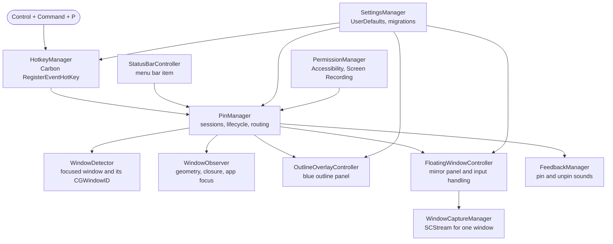
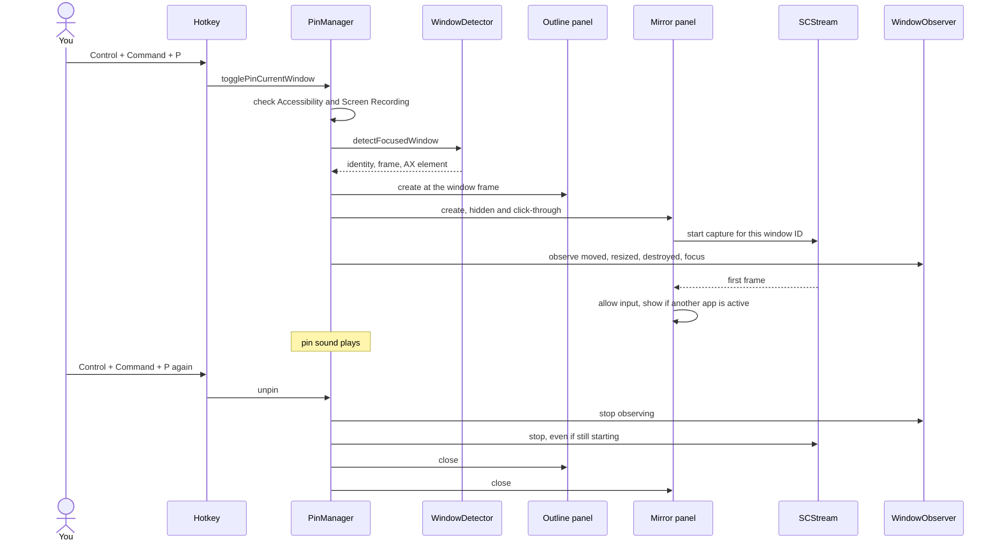

# Architecture

Topmost is a menu bar utility written in Swift. This page describes how its parts fit together. For the reasoning behind the main choices, see [TECHNICAL_DECISIONS.md](TECHNICAL_DECISIONS.md). For what macOS does not allow, see [LIMITATIONS.md](LIMITATIONS.md).

## Overview

macOS has no public API for one app to raise another app's window above everything else. Topmost works around that with a **mirror**: a borderless panel at the floating window level that shows a live picture of the pinned window, streamed by ScreenCaptureKit. The panel stays above other apps. When you use the pinned window, Topmost steps out of the way and you work in the real one.

## Modules

The package has three targets, declared in `Package.swift`.

| Target | Path | Role |
| --- | --- | --- |
| `Topmost` | `Sources/Topmost` | The executable. `main.swift` sets the activation policy to accessory (no Dock icon), starts the hotkey and menu bar item, and opens Settings on launch. Also holds `Info.plist`, the entitlements and the icon. |
| `TopmostCore` | `Sources/TopmostCore` | A library with everything else, so it can be tested without launching the app. |
| `TopmostTests` | `Tests/TopmostTests` | An executable test runner. `swift test` does not run it; use `./scripts/test.sh`. |

### TopmostCore

| File | Responsibility |
| --- | --- |
| `PinManager` | Owns every pinned session, keyed by `WindowIdentity`. Applies the single or multiple pin policy, routes events from the observer and the mirror, and removes a pin when capture fails. |
| `WindowDetector` | Finds the focused window of the target app through Accessibility, resolves its `CGWindowID`, and converts between Accessibility and Cocoa coordinates. Returns a `DetectedWindow`. |
| `WindowIdentity`, `WindowInfo` | The identity is the process ID plus the window ID. Titles are excluded from equality so editing a document does not unpin it. |
| `WindowObserver` | Watches pinned windows for movement, resize, closure and focus changes, and reports app activation. Tracks at 10 Hz when idle and about 120 Hz while something moves. |
| `FloatingWindowController` | The mirror panel. Decides whether the mirror is shown, and turns presses on it into activation, window drags and replayed clicks. |
| `WindowCaptureManager` | One `SCStream` per pinned window. Safe to stop at any moment, including while it is still starting. |
| `OutlineOverlayController` | The click-through blue outline panel. |
| `HotkeyManager` | Registers the global hotkeys with the Carbon Event Manager. No event tap, no keystroke access. |
| `StatusBarController` | The menu bar item, its menu, and the pinned windows list. |
| `SettingsManager` | Preferences in `UserDefaults`, a schema version for migrations, and the defaults. |
| `SettingsView`, `SettingsWindowController` | The SwiftUI settings window with five tabs. |
| `PermissionManager` | Reads and requests Accessibility and Screen Recording. Exposed through `PermissionProviding` so tests can inject it. |
| `FeedbackManager`, `LoginItemManager` | Sounds, and launch at login through `SMAppService`. |
| `AccessibilityHelpers` | Safe casts for Accessibility values, the shared call timeout, and the overlay Space behavior. |
| `AppInfo` | The version string, read from the app bundle. |

## Pin lifecycle

If capture cannot start or stops, `PinManager` removes the pin and plays the error sound. A mirror that has nothing to show would otherwise be a transparent rectangle that swallows clicks.

## Interaction states

The mirror is always in one of four states. `FloatingWindowController.applyInteractionState()` picks it.

| State | When | Mirror | Mouse |
| --- | --- | --- | --- |
| **No picture yet** | Before the first captured frame | Not shown | Passes through |
| **Native** | The pinned app is active and the pinned window is its focused window | Hidden | You use the real window |
| **Mirrored** | Anything else | Shown above other apps | Presses go to the mirror |
| **Gesture** | A press on the mirror is in progress | Shown | Mirror keeps the whole press, until you release |

The gesture state matters. Activating the pinned app flips Topmost to Native in the middle of your press. Without the gesture state, the rest of the drag would skip the mirror and nothing would move the window.

### A press on the mirror

1. `mouseDown`: raise and activate the real app by setting `AXFrontmost`, and record the pointer position, the mirror frame and the window origin.
2. `mouseDragged`: once the pointer has moved 3 points, and only if the press began in the top 44 points (the title strip), move the mirror and outline to follow the pointer now, and ask the real window to move there. The Accessibility write is limited to 60 per second and never waited on for display.
3. `mouseUp`: write the exact final position. If there was no drag, replay the click at that point so it reaches the real window.

Pointer position comes from `NSEvent.mouseLocation`, not from the event's position inside the mirror. The mirror moves while you drag, so window-relative positions shift under the pointer and feed back into the move.

## Window tracking

`WindowObserver` combines three sources, because no single one is both fast and complete.

- **AXObserver notifications** for moved, resized and destroyed on each pinned window, and for focus changes on the app. These arrive first but only for apps that send them.
- **A timer** that looks up each pinned window with `CGWindowListCreateDescriptionFromArray`, which costs about 0.1 ms. It runs at 10 Hz when nothing moves and at about 120 Hz while something does, then relaxes after 0.4 seconds of stillness.
- **A global mouse-drag monitor**, which switches to fast tracking the moment a drag starts, before the window server reports new geometry. Mouse monitoring needs no extra permission.

A window that no longer exists is reported as closed and its pin is removed. The check does not use the on-screen list, so switching Spaces never unpins a window.

## Capture

`WindowCaptureManager` uses `SCContentFilter(desktopIndependentWindow:)`, so only the pinned window is captured, never the display or other windows. Frames are zero-copy `IOSurface` objects set as the mirror layer's contents.

- Frames arrive on a capture queue. The controller keeps only the latest one and schedules a single main-thread update, so a busy main thread can never build up a queue of frames.
- Resize updates to the stream are debounced by 100 ms.
- `stop()` is idempotent and safe while `start()` is suspended: a stream that finishes starting after a stop is torn down instead of kept.

## Settings and migrations

`SettingsManager` registers defaults, runs `migrateIfNeeded()`, then loads values. Each change to a published property is saved immediately, which also means a build's defaults are written to disk on first launch. A change of default that must override those saved values needs a bump of `currentSchemaVersion` and a migration step. Version 2 reset the click behavior to pass-through.

## Concurrency

Everything that touches AppKit, the observer and the panels runs on the main thread. The capture queue only hands frames to `FloatingWindowController` through a lock-protected slot. `WindowCaptureManager` guards its state with an `NSLock` because `start()` is async and `stop()` can arrive from any thread.
