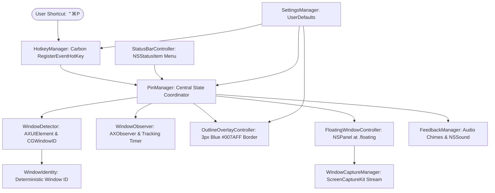

# Topmost Architecture & Systems Design

## Overview

**Topmost** is a lightweight native macOS utility designed to replicate Windows PowerToys *Always on Top*. It allows users to pin any application window above normal desktop windows using a global keyboard shortcut (`Control + Command + P`).

---

## Component Diagram

---

## Key Modules

### 1. `TopmostApp` & `AppDelegate` (`Sources/Topmost/`)
- Entry point for the application.
- Configures `NSApplication.ActivationPolicy.accessory` (menu bar utility mode, no Dock icon).
- Registers lifecycle observers and initiates hotkeys and status items.

### 2. `TopmostCore` (`Sources/TopmostCore/`)

#### `HotkeyManager`
- Uses Carbon Event Manager's `RegisterEventHotKey` and `InstallEventHandler`.
- Operates at the WindowServer event dispatcher level without installing invasive event taps or polling the keyboard.
- Handles primary toggle hotkey (`Control + Command + P`) and optional "Unpin Most Recent" shortcut (`Control + Command + U`).

#### `WindowDetector`
- Identifies the frontmost application using `NSWorkspace.frontmostApplication`.
- Locates the focused window using the Accessibility API (`kAXFocusedWindowAttribute` and `kAXMainWindowAttribute`).
- Resolves the native `CGWindowID` using `_AXUIElementGetWindow` with proximity fallback matching via `CGWindowListCopyWindowInfo`.
- Converts coordinates accurately between Accessibility top-left screen origin and Cocoa bottom-left screen origin.

#### `WindowIdentity` & `WindowInfo`
- `WindowIdentity`: Struct pairing `processID`, `windowID`, `bundleIdentifier`, and `windowTitle`.
- Guarantees deterministic equality and hashing so that window title changes (such as editing a document in TextEdit or changing browser tabs) do not disrupt the pinned state.

#### `PinManager`
- Manages the lifecycle of all active pins in `[WindowIdentity: PinnedSession]`.
- Enforces single or multi-window pinning policies based on user configuration.
- Coordinates visual feedback, capture streaming, and window geometry tracking.

#### `OutlineOverlayController`
- Spawns a dedicated, non-interactive `NSPanel` (`ignoresMouseEvents = true`) at `NSWindow.Level.floating`.
- Renders a 3px solid blue outline (`#007AFF`) with 10pt corner radius conforming to the window's exact shape.
- Updates dynamically on window repositioning and resizing.

#### `FloatingWindowController` & `WindowCaptureManager`
- Operates an `NSPanel` at `NSWindow.Level.floating` with `.canJoinAllSpaces` collection behavior.
- Manages a hardware-accelerated `SCStream` with `SCContentFilter(desktopIndependentWindow: scWindow)`.
- Enqueues video frames via zero-copy `IOSurface` onto a `CALayer`.
- Implements the honest interaction model: clicking on the mirrored overlay brings the real application and window forward with native keyboard focus.

#### `FeedbackManager`
- Dispatches asynchronous audio feedback upon pin (`NSSound(named: "Tink")`) and unpin (`NSSound(named: "Pop")`).
- Volume and enable/disable toggles are configurable in Settings.

#### `SettingsManager` & `SettingsView`
- Centralized `UserDefaults` storage.
- Native SwiftUI settings window with tabs: General, Appearance & Feedback, Behavior, Permissions, and About.
